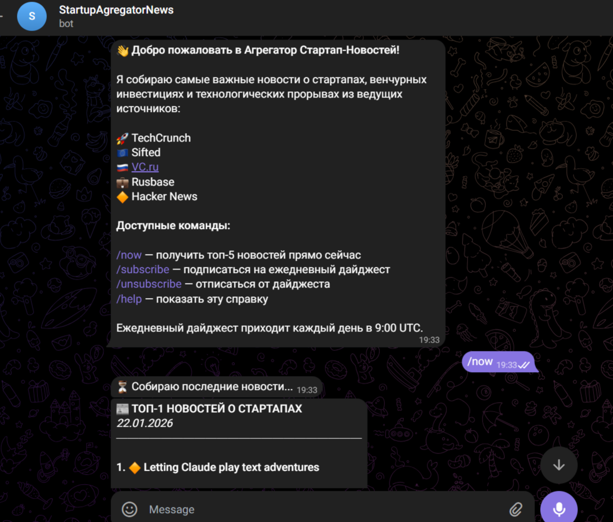

# Startup News Aggregator Bot

This project is a Telegram bot designed for automated monitoring and aggregation of news regarding startups and venture capital investments.



## Features

- **Automated Parsing** from 5 sources:
  - TechCrunch (Startups)
  - Sifted (European startups)
  - VC.ru (Tribune/Startups)
  - Rusbase (Venture news)
  - Hacker News (Tech trends)

- **Intelligent Filtering**:
  - Automatic duplicate removal
  - Ranking by relevance and freshness
  - Priority for news about investments, rounds, and deals

- **AI Functions** (Optional, requires OpenAI API):
  - AI summarization of each article
  - Insight and trend generation
  - Market sentiment analysis
  - Smart weekly reports

- **Telegram Interface**:
  - `/start` - Greeting and instructions
  - `/now` - Instant top 5 news
  - `/subscribe` - Subscribe to daily digest
  - `/unsubscribe` - Unsubscribe from digest
  - `/help` - Help
  
  **AI Commands**:
  - `/summary` - AI summaries of top news
  - `/insights` - Weekly insights
  - `/trends` - Trending topics (3 days)
  - `/sentiment` - Market sentiment analysis

- **Automation**:
  - Parsing every 2 hours
  - Daily digest at 09:00 UTC
  - Automatic AI processing of new articles (if enabled)

## Quick Start

### 1. Install Dependencies

```bash
venv\Scripts\activate

pip install -r requirements.txt
```

### 2. Create Telegram Bot

1. Find [@BotFather](https://t.me/BotFather) in Telegram.
2. Send the `/newbot` command.
3. Follow the instructions and copy the token.
4. Create a `.env` file based on `.env.example`:

```bash
cp .env.example .env
```

5. Open `.env` and insert your token:

```env
TELEGRAM_BOT_TOKEN=your_token_from_BotFather
DATABASE_URL=sqlite:///news_aggregator.db
DIGEST_TIME=09:00
PARSING_INTERVAL_HOURS=2
```

### 3. Initialize Database

```bash
python -c "from src.models import init_db; init_db()"
```

### 4. (Optional) Enable AI Features

To use AI capabilities:

```bash
pip install -r requirements-ai.txt

# Add to .env:
# ENABLE_AI_FEATURES=true
# OPENAI_API_KEY=sk-your-key-here
# AI_MODEL=gpt-3.5-turbo
```

**Estimated Cost**: $10-15/month with active usage.

### 5. Run Bot

```bash
python run.py
```

## Project Structure

```
AgregatorNews/
├── src/
│   ├── scrapers/          # News source parsers
│   │   ├── base.py        # Base class
│   │   ├── techcrunch.py
│   │   ├── sifted.py
│   │   ├── vcru.py
│   │   ├── rusbase.py
│   │   └── hackernews.py
│   ├── bot/               # Telegram bot
│   │   ├── handlers.py    # Command handlers
│   │   └── formatter.py   # Message formatting
│   ├── models.py          # Database models
│   ├── processor.py       # Processing and ranking
│   ├── scheduler.py       # Task scheduler
│   └── main.py           # Main file
├── requirements.txt       # Dependencies
├── .env.example          # Configuration example
├── .gitignore
└── run.py                # Entry point
```

## Configuration

### Environment Variables (.env)

| Variable | Description | Default |
|----------|-------------|---------|
| `TELEGRAM_BOT_TOKEN` | Token from BotFather | *required* |
| `DATABASE_URL` | Path to database | `sqlite:///news_aggregator.db` |
| `DIGEST_TIME` | Daily digest time (UTC) | `09:00` |
| `PARSING_INTERVAL_HOURS` | Parsing interval (hours) | `2` |

### Ranking Algorithm

News is ranked by two criteria:

1. **Keywords** (Primary): investments, rounds, funding, IPO, acquisitions, etc.
2. **Freshness** (Secondary): new articles have priority.

## Testing

### Test Individual Scrapers

```bash
python -m src.scrapers.techcrunch

python -m src.scrapers.sifted

python -m src.scrapers.vcru

python -m src.scrapers.rusbase

python -m src.scrapers.hackernews
```

### Test Processing and Saving

```bash
python -m src.processor
```

### Test /now Command

1. Run the bot: `python run.py`
2. Find the bot in Telegram.
3. Send `/now`.

## Database

SQLite database with two tables:

### NewsArticle
- `id` - Primary key
- `title` - Title
- `url` - Link (unique)
- `description` - Description
- `source` - Source
- `published_date` - Publication date
- `keywords_score` - Relevance score

### User
- `id` - Primary key
- `telegram_id` - User ID in Telegram
- `username` - Username
- `subscribed` - Digest subscription
- `created_at` - Registration date

## Deployment

### Local Run

Simply run `python run.py` and keep the terminal open.

### Server Deployment

1. **VPS/Cloud Server** (Recommended):
   ```bash
   git clone <your-repo-url>
   cd AgregatorNews
   
   pip install -r requirements.txt
   
   nano .env
   
   screen -S newsbot
   python run.py
   ```

2. **Heroku**:
   - Create `Procfile`: `worker: python run.py`
   - Set environment variables in settings.
   - Deploy via Git.

3. **PythonAnywhere**:
   - Upload code.
   - Configure .env.
   - Run as Always-On Task.

## Development

### Adding a New Source

1. Create a new file in `src/scrapers/`.
2. Inherit from `BaseScraper`.
3. Implement `scrape()` method.
4. Add to `process_all_sources()` in `processor.py`.

Example:

```python
from .base import BaseScraper

class NewSourceScraper(BaseScraper):
    def __init__(self):
        super().__init__('NewSource')
        self.base_url = 'https://...'
    
    def scrape(self):
        html = self.fetch_page(self.base_url)
        return articles
```

## Troubleshooting

### Bot Does Not Start
- Check if `TELEGRAM_BOT_TOKEN` is set in `.env`.
- Ensure all dependencies are installed.

### Parsers Not Working
- Site structure may have changed.
- Check logs for specific errors.
- Sites may block scraping (try changing User-Agent).

### Database Locked
- SQLite does not support many concurrent writes.
- Use PostgreSQL for production.

## License

MIT License

## Author

Test assignment for developer position.

## Links

- [TechCrunch](https://techcrunch.com)
- [Sifted](https://sifted.eu)
- [VC.ru](https://vc.ru)
- [Rusbase](https://rb.ru)
- [Hacker News API](https://github.com/HackerNews/API)
- [python-telegram-bot](https://python-telegram-bot.org)
